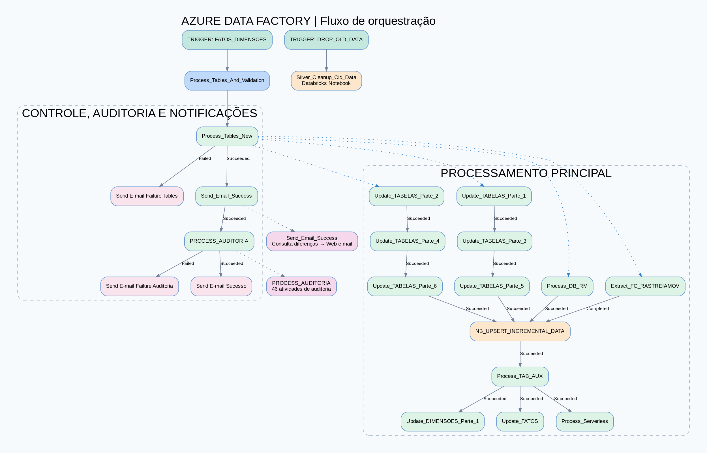
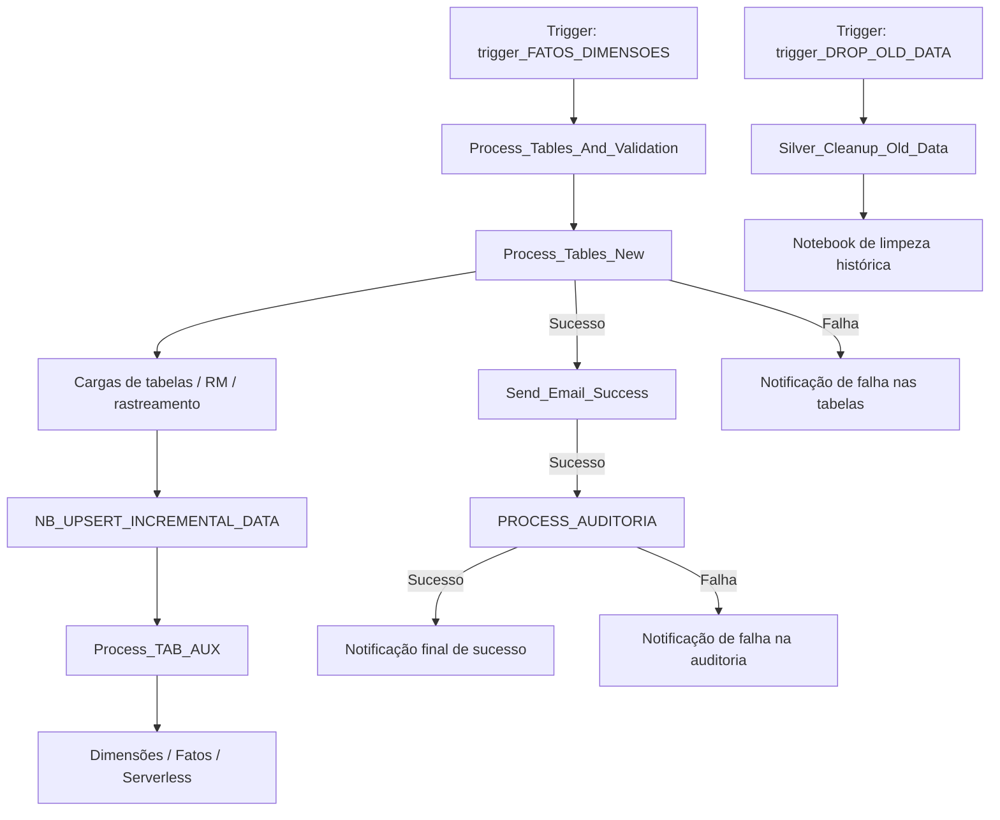

# Orquestração de Dados com Azure Data Factory | ETL/ELT e Data Warehouse


> **Estudo de caso técnico de uma arquitetura de integração e processamento de dados**, documentada a partir da análise de um export ARM do Azure Data Factory. Este repositório apresenta a orquestração, suas dependências e os padrões de processamento observados, sem expor configurações sensíveis do ambiente.

## Visão geral

A solução organiza cargas de dados em pipelines reutilizáveis, executa transformações e atualizações incrementais, processa entidades analíticas (dimensões e fatos), realiza auditorias e emite notificações operacionais.

O Azure Data Factory atua como **orquestrador**, integrando atividades de cópia, Data Flows, notebooks do Azure Databricks e serviços de armazenamento/consulta. O fluxo principal contempla caminhos explícitos de sucesso e falha.

## Arquitetura visual



[Ver diagrama em SVG (alta resolução)](assets/fluxo-adf.svg)

> O desenho representa uma visão da orquestração principal. Ele não significa que todos os 917 pipelines sejam executados em uma única carga, nem substitui o detalhamento de cada atividade.

### Resumo do fluxo principal



**Nota sobre dependências:** o diagrama acima é uma simplificação didática. Dentro de `Process_Tables_New`, existem ramos paralelos e dependências específicas: `Update_TABELAS_Parte_1 → Parte_3 → Parte_5` e `Parte_2 → Parte_4 → Parte_6`, além de `Process_DB_RM` e `Extract_FC_RASTREIAMOV`. O notebook incremental aguarda a conclusão prevista desses ramos; para o rastreamento, a condição configurada é `Completed` (não necessariamente `Succeeded`).

## Etapas do processo

| Etapa | Componente | Responsabilidade |
|---|---|---|
| 1. Agendamento | `trigger_FATOS_DIMENSOES` | Iniciar a execução recorrente |
| 2. Orquestração | `Process_Tables_And_Validation` | Coordenar carga, notificação e auditoria |
| 3. Cargas | `Process_Tables_New` | Acionar grupos de tabelas, integrações e dependências |
| 4. Atualização incremental | `NB_UPSERT_INCREMENTAL_DATA` | Executar notebook Databricks |
| 5. Processamento analítico | `Process_TAB_AUX`, `Update_DIMENSOES_Parte_1`, `Update_FATOS` | Preparar tabelas auxiliares, dimensões e fatos |
| 6. Validação | `PROCESS_AUDITORIA` | Executar pipelines de auditoria |
| 7. Comunicação | `Send_Email_Success` e Web Activities | Consultar diferenças e emitir notificações |
| 8. Manutenção independente | `Silver_Cleanup_Old_Data` | Executar rotina de limpeza da camada Silver |

### Camadas de dados

A nomenclatura dos datasets e Data Flows evidencia o uso das camadas **Landing, Bronze, Silver e Gold**. Em termos arquiteturais, elas podem ser compreendidas assim:

```text
Sistemas de origem / ERP
         │
         ▼
Landing (recepção)
         │
         ▼
Bronze (persistência inicial)
         │
         ▼
Silver (tratamento e atualização)
         │
         ▼
Gold (dados analíticos)
         │
         ▼
Dimensões / Fatos / Consumo
```

Esse esquema descreve o **padrão de camadas** encontrado no ambiente; o encadeamento exato varia conforme o pipeline e deve ser confirmado em cada atividade de origem e destino.

## Tecnologias identificadas

- **Azure Data Factory:** orquestração, pipelines, triggers, datasets e Mapping Data Flows.
- **Azure Databricks:** notebooks para processamento incremental e manutenção.
- **Azure Synapse Analytics:** serviços vinculados de consulta e data warehouse.
- **Data Lake:** armazenamento de dados em camadas.
- **Azure Key Vault:** integração de gerenciamento de segredos via Linked Service.
- **ARM Templates:** exportação e definição declarativa de recursos Azure.

## Inventário do export ARM

Contagem de **recursos únicos por nome**, após eliminar referências repetidas nos templates vinculados:

| Recurso | Quantidade |
|---|---:|
| Pipelines | **917** |
| Datasets | **960** |
| Mapping Data Flows | **389** |
| Linked Services | **7** |
| Triggers | **2** |
| Integration Runtimes | **1** |

> O pacote inclui múltiplos templates ARM vinculados. As contagens acima representam os objetos únicos identificados no export, não o número de execuções em produção.

## Decisões e práticas de engenharia

- **Modularização:** separação das cargas por grupos e por tipo de entidade.
- **Paralelismo controlado:** ramos independentes avançam em paralelo e convergem antes de etapas dependentes.
- **Incrementalidade:** notebooks dedicados a operações de atualização incremental.
- **Observabilidade operacional:** caminhos distintos para falhas nas cargas e falhas na auditoria.
- **Qualidade de dados:** etapa específica de auditoria antes da confirmação final de sucesso.
- **Manutenção:** trigger separado para limpeza histórica na Silver.

## O que este projeto demonstra

Este estudo de caso evidencia competências em **engenharia de dados**, **leitura e documentação de arquiteturas Azure**, **análise de dependências entre pipelines**, **orquestração ETL/ELT**, **modelagem de fluxos analíticos** e **comunicação técnica por diagramas**.

## Estrutura sugerida do repositório

```text
.
├── README.md
└── assets/
    ├── fluxo-adf.png
    └── fluxo-adf.svg
```

## Segurança e confidencialidade

Este portfólio foi pensado para publicar **somente a documentação e os diagramas**. **Não publique o ZIP ARM original sem revisão e autorização**, pois exports podem conter nomes internos de serviços, servidores, bancos, caminhos, endpoints, identificadores e parâmetros operacionais. Revise também os diagramas e este README para remover qualquer nomenclatura confidencial antes de disponibilizá-los publicamente.

---

*Documentação elaborada a partir da inspeção estática de um export ARM. Não representa medição de performance, validação de execução em produção ou auditoria de segurança do ambiente.*
